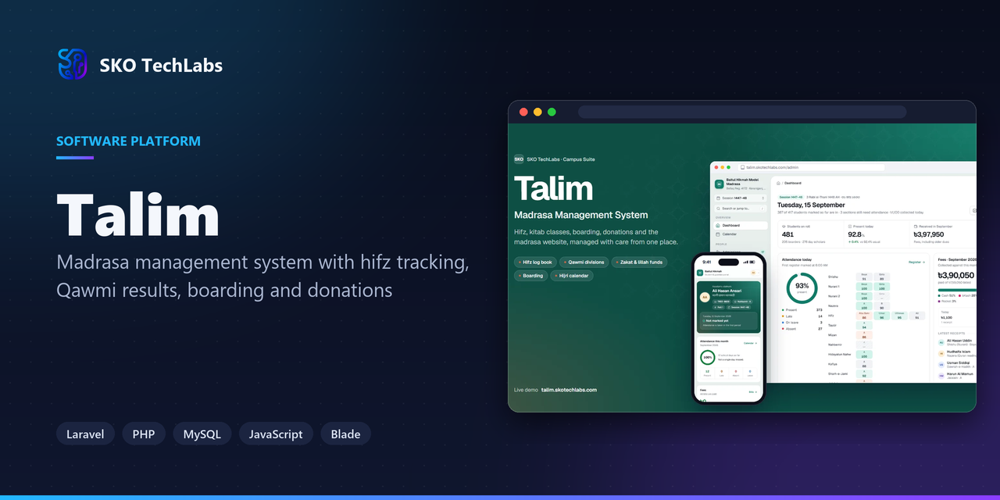
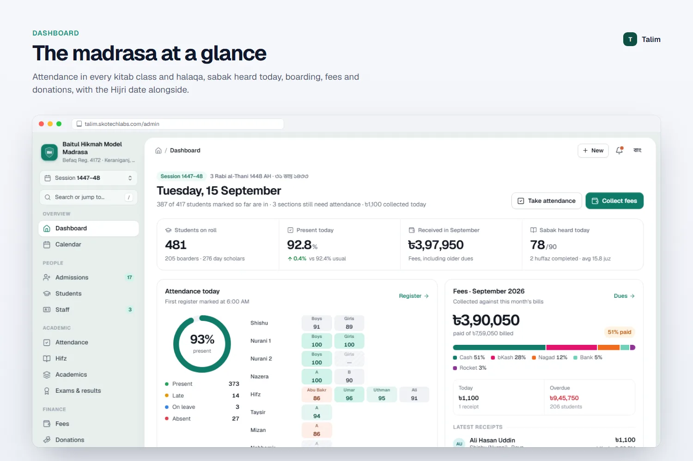
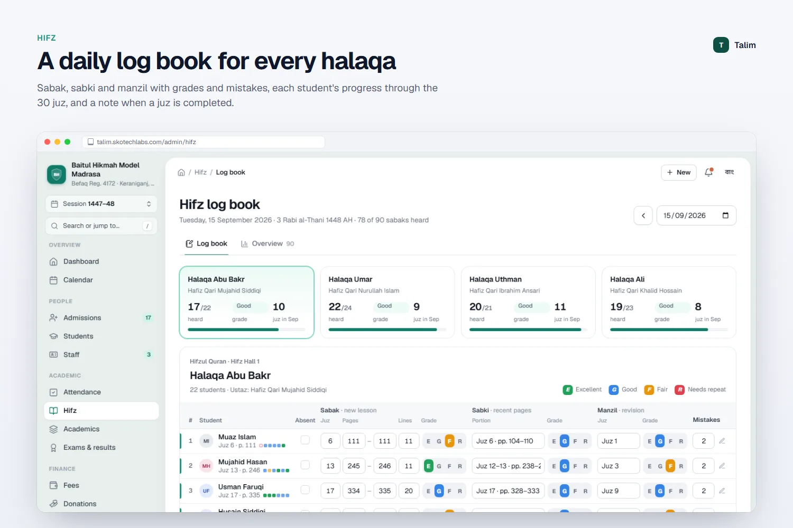
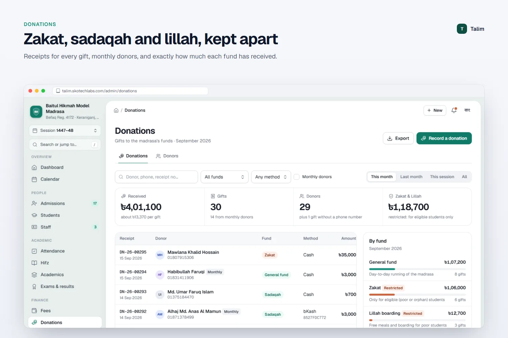
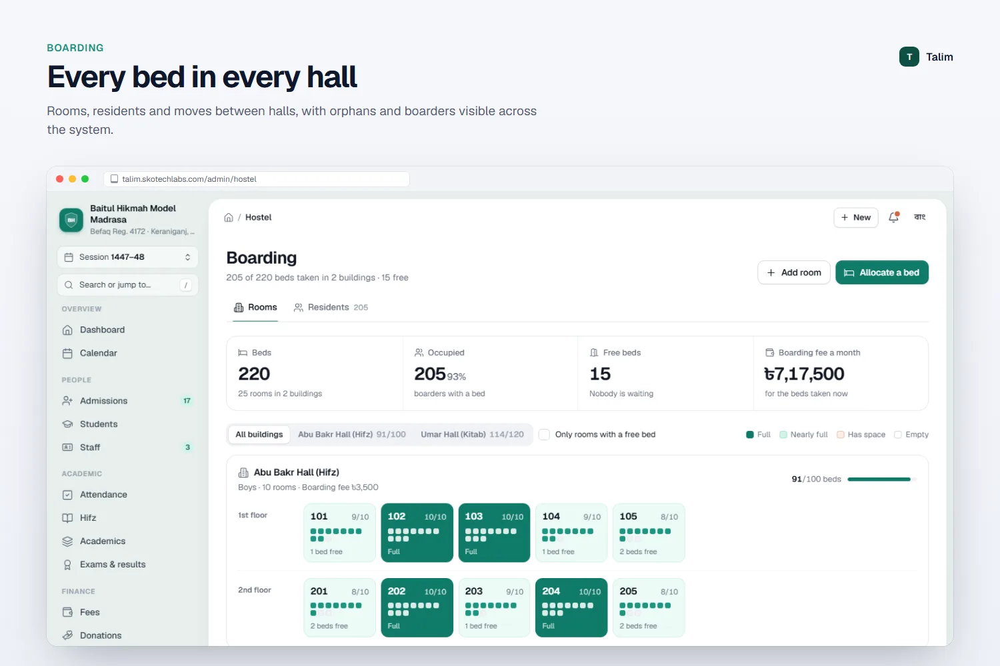
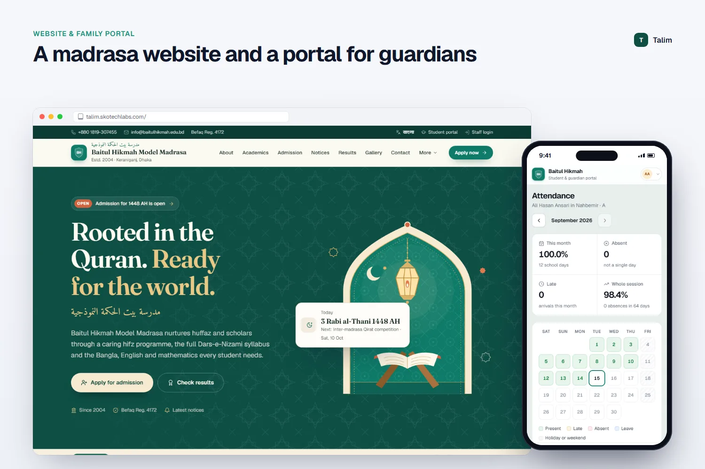

<h3>Madrasa management system with hifz tracking, Qawmi results, boarding and donations</h3>

A madrasa management system for Nurani, Hifzul Quran and Kitab divisions: daily hifz sabak tracking, Qawmi exam results, boarding, donations with zakat and lillah funds, fees, payroll, a madrasa website and a guardian portal, all from one admin dashboard.

   

<a href="https://talim.skotechlabs.com"><b>Live Demo</b></a> &nbsp;·&nbsp; <a href="https://skotechlabs.com/projects/talim-madrasa-management-system"><b>Case Study</b></a> &nbsp;·&nbsp; <a href="https://skotechlabs.com/contact"><b>Request a Demo</b></a> &nbsp;·&nbsp; <a href="https://github.com/skotechlabs"><b>All Products</b></a>

---

## Overview

Talim is built around how a madrasa actually works. The dashboard shows the Hijri and Bangla date, how many sabaks have been heard in each halaqa, who is absent, which boarders are in, what was collected in fees and donations and which exams and programmes are coming up.

Hifz teachers record every student's sabak, sabki and manzil with the quality of recitation and mistakes in a fast daily log book. Each student has a 30-juz progress map, a pace chart and a projected completion date, and the madrasa can see its huffaz and every halaqa's progress at a glance.

The Kitab division follows the Dars-e-Nizami classes from Taysir to Dawrah-e-Hadith with Arabic kitab names, and results are processed in Qawmi divisions from Mumtaz to Rasib with printable mark sheets. Boarding rooms and residents, lillah and orphan waivers, monthly tuition and boarding fees, payroll and a full cashbook keep the accounts transparent.

Donations are recorded by fund, with zakat and lillah kept separate, monthly donors tracked and dignified receipts printed. A madrasa website, notices, SMS to guardians, a student and guardian portal, roles for the muhtamim, office, accountant and asatiza, and an activity log complete the system.

<table>
<tr>
<td width="50%" valign="top">

### The Challenge

Madrasas keep hifz progress in teachers' notebooks, donations in receipt books and boarding fees in separate ledgers, so the muhtamim rarely sees the whole picture. Zakat and lillah money must stay separate from general funds, many students study free, and guardians far away want to know how their child's memorisation is going. Generic school software does not understand halaqas, kitab classes or Qawmi grading.

</td>
<td width="50%" valign="top">

### Our Solution

We adapted the Campus Suite engine into a madrasa edition with its own wording, jade and terracotta design, Arabic kitab names and Hijri dates. A purpose-built hifz log book records each day in seconds and feeds progress maps, the dashboard and the guardian portal. Donations are tracked by fund with restricted funds kept apart, waivers flow into monthly invoices automatically, and results use Qawmi divisions end to end.

</td>
</tr>
</table>

## Key Features

- Dashboard with Hijri and Bangla dates, hifz progress, attendance, boarding, fees and donations
- Hifz daily log book: sabak, sabki and manzil with recitation quality and mistakes for every halaqa
- Student hifz journey with a 30-juz map, pace chart, projected completion and huffaz list
- Nurani, Hifzul Quran and Kitab divisions with Arabic kitab names from Taysir to Dawrah-e-Hadith
- Qawmi results from Mumtaz to Rasib, merit positions and printable mark sheets
- Donations by fund with zakat and lillah kept separate, monthly donors and receipts
- Boarding rooms, residents and lillah or orphan waivers on tuition and boarding fees
- Fee invoices, collection desk, dues, cashbook, payroll and staff leave
- Admissions, attendance with absence SMS, class routine, library and certificates
- Madrasa website, notices, student and guardian portal, roles and activity log
- Reports for student strength, attendance shortfall, result analysis, fee collection and income and expense
- Full Bangla and English interface with Bangla digits, Hijri and Bangla calendars

## Business Impact

- Every hifz student's daily sabak recorded and visible to the muhtamim
- Zakat, lillah and general funds reported separately and transparently
- Free and waived students handled automatically in monthly fees
- Guardians follow memorisation, attendance and results from home
- One system for the office, asatiza, accounts and boarding

## Screenshots

<table>
<tr>
<td width="50%" valign="top"> The madrasa at a glance</td>
<td width="50%" valign="top"> A daily log book for every halaqa</td>
</tr>
<tr>
<td width="50%" valign="top"> Zakat, sadaqah and lillah, kept apart</td>
<td width="50%" valign="top"> Every bed in every hall</td>
</tr>
<tr>
<td width="50%" valign="top"> A madrasa website and a portal for guardians</td>
<td width="50%"></td>
</tr>
</table>

> See it running: **[talim.skotechlabs.com](https://talim.skotechlabs.com)**

## Technology Stack

## Source Code & Licensing

This repository is the public showcase for **Talim**. The production source code is proprietary and is maintained privately by SKO TechLabs.

Interested in this product for your business? We offer:

- **Ready-to-launch deployment** of Talim under your own brand and domain
- **Customisation** of features, workflows, languages and integrations to fit how you work
- **Custom development** of a new product built on the same foundations
- **Ongoing support**, hosting, maintenance and feature roll-outs after launch

## Get in Touch

---

© 2026 <a href="https://skotechlabs.com">SKO TechLabs</a> · Dhaka, Bangladesh · Building intelligent digital solutions

